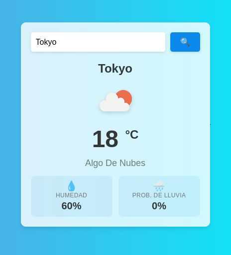

# App del Tiempo ⛅

Una app sencilla para consultar el tiempo de una ciudad. La hice como proyecto de aprendizaje para practicar **HTML, CSS y JavaScript** sin frameworks.



## ¿Qué hace?

- Busca el tiempo de una ciudad por su nombre.
- Muestra la temperatura, la descripción y un icono.
- Muestra la humedad y la probabilidad de lluvia.
- Cambia el fondo entre día y noche según la hora de la ciudad.
- Muestra un spinner mientras espera la respuesta de la API.

## Tecnologías

- HTML5
- CSS3
- JavaScript (vanilla, sin frameworks)
- [OpenWeatherMap API](https://openweathermap.org/api)

## Cómo ejecutarlo

1. Clona el repositorio:

   ```bash
   git clone https://github.com/sburgos28/app-tiempo.git
   cd app-tiempo
   ```

2. Crea tu archivo de configuración:

   ```bash
   cp config.example.js config.js
   ```

3. Abre `config.js` y pega tu API key:

   ```js
   window.OPENWEATHER_API_KEY = 'TU_API_KEY_AQUI';
   ```

   Puedes conseguir una gratis en [OpenWeatherMap](https://openweathermap.org/api).
   Las claves nuevas pueden tardar un poco en activarse.

4. Abre `index.html` en el navegador. No hace falta servidor local.

> `config.js` está en `.gitignore`, así que tu clave no se sube a GitHub.

## Estructura del proyecto

```
app-tiempo/
├── index.html          # Estructura de la página
├── style.css           # Estilos (día/noche, spinner, tarjetas...)
├── app.js              # Lógica y peticiones a la API
├── config.example.js   # Plantilla para la API key
├── config.js           # Tu API key (no se sube)
└── README.md
```

## Despliegue en GitHub Pages

El repositorio incluye un workflow de GitHub Actions (`.github/workflows/deploy.yml`) que genera `config.js` con el secret `OPENWEATHER_API_KEY` y publica la web en GitHub Pages.

Para configurarlo, añade el secret en **Settings → Secrets and variables → Actions**, o desde la terminal:

```bash
gh secret set OPENWEATHER_API_KEY
```

La web quedará publicada en `https://sburgos28.github.io/app-tiempo/`.

> En una web estática la clave se puede ver desde el navegador. El secret sirve para que no esté guardada en el repositorio.

## Notas

- Si aparece "Ciudad no encontrada", revisa que el nombre de la ciudad esté bien escrito.
- Si sale un error con `HTTP 401`, probablemente la API key no esté bien puesta o todavía no esté activada.

## Cosas que me gustaría añadir

- [ ] Previsión de los próximos días.
- [ ] Botón para cambiar entre °C y °F.
- [ ] Geolocalización para cargar el tiempo actual.
- [ ] Guardar la última ciudad buscada.
- [ ] Mostrar más datos: viento, sensación térmica...

## Autor

Proyecto de aprendizaje hecho por [sburgos28](https://github.com/sburgos28).

Uso libre para aprender.
